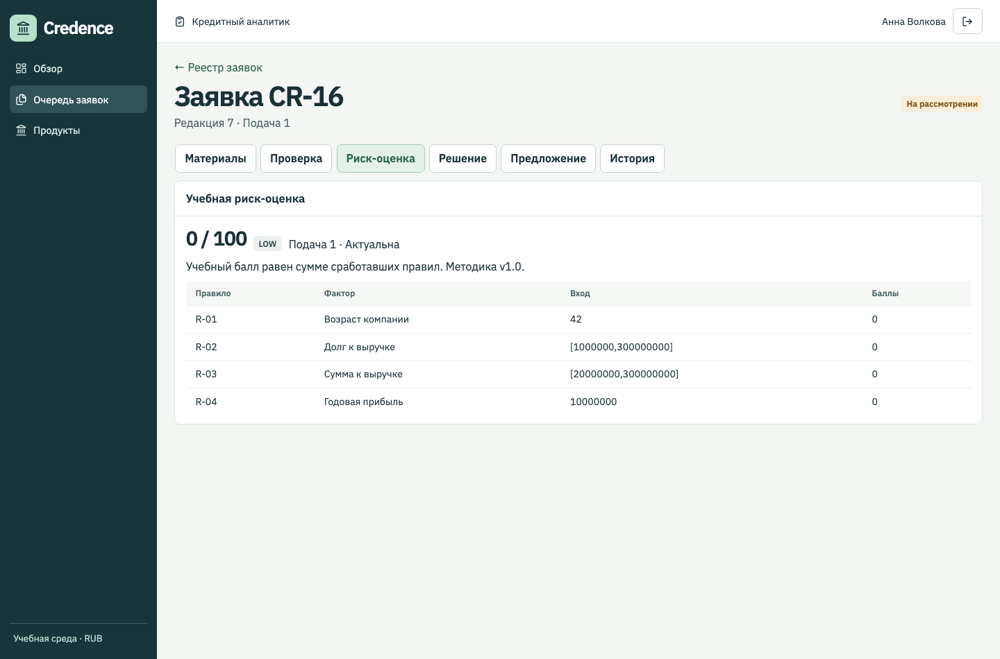

# Credence

Учебная платформа цифрового кредитования / Educational loan origination platform.

**[Русский](README.ru.md) · [English](README.en.md)**

Заявка → проверка → объяснимая оценка → независимое решение → предложение.

```sh
docker compose up --build
```

[Стенд](http://127.0.0.1:8110) · [Архитектура](docs/architecture.md) · [Проверки](docs/verification.md) · [Статус](docs/PROJECT_STATUS.md)


